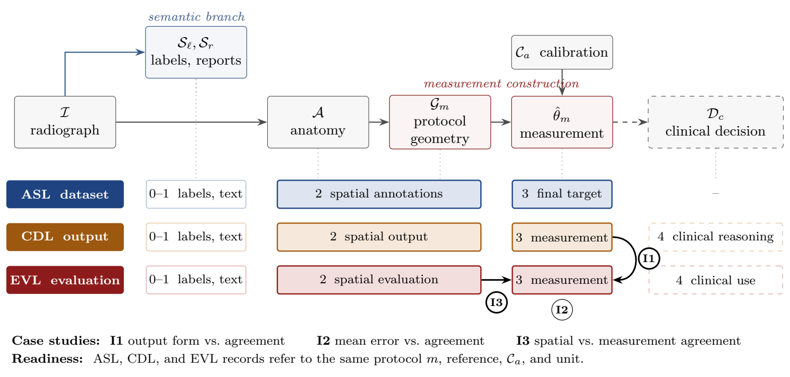
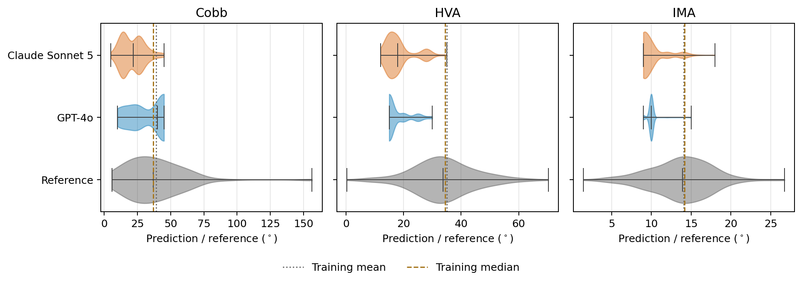

<div align="center">

# Measurement Readiness in Musculoskeletal Radiography
### A Geometry-Centric Framework and Evaluation

Hongcheng Jiang<sup>1</sup>, ZhiQiang Chen<sup>1</sup>, Caleb W. Grote<sup>2</sup>, Sherwin S. Chan<sup>2</sup>,<br>
Cheng Han<sup>1</sup>, Rong Wang<sup>3</sup>, Dianxiang Xu<sup>1</sup>

<sup>1</sup> School of Science and Engineering, University of Missouri-Kansas City<br>
<sup>2</sup> Children's Mercy Research Institute, Children's Mercy Hospital<br>
<sup>3</sup> School of Dentistry, University of Missouri-Kansas City

[**Overview**](#overview) · [**Results**](#key-findings) · [**Quick start**](#quick-start) · [**Training**](#data-and-training) · [**Citation**](#citation)


[](code/LICENSE)

</div>

**TL;DR:** A plausible angle, low mean error, or accurate spatial output alone does not establish case-level measurement agreement. We connect dataset annotations, model outputs, and evaluation through the anatomy and protocol that define the measurement.

<p align="center">
  
</p>

## Overview

The **Geometric Construction Pathway** traces a radiograph through anatomy and protocol geometry to a measurement and its intended use. Three separately assigned dimensions describe the evidence:

- **Annotation Support Level (ASL):** what a dataset supplies.
- **Capability Description Level (CDL):** what a model outputs on a specified task.
- **Evaluation Variable Level (EVL):** what a study directly evaluates.

The framework is applied to a purposive review of **15 datasets and 19 model–task outputs from 13 studies**, with case studies of Cobb angle, hallux valgus angle (HVA), and intermetatarsal angle (IMA). The code covers constant predictors, prompt-only vision-language models, frozen-encoder readouts, end-to-end regressors, and a structured foot-axis pathway.

## Key findings

| Evidence examined | Observation |
| --- | --- |
| Dataset support and evaluated outputs | 4/15 datasets supply structured final targets; 5/19 outputs produce protocol-defined measurements. All five have measurement-reference evaluation; none has clinical-use evaluation in the coded inventory. |
| Numerical output versus agreement | Prompt-only GPT-4o and Claude Sonnet 5 have higher HVA and IMA MAE than the training-median predictor (Holm-adjusted *p* < 0.001); foot-angle ICCs are 0.024–0.118. |
| Spatial versus measurement agreement | Two Dice-selected foot-axis runs have nearly identical clDice (0.820 / 0.819), but IMA ICCs of 0.762 / 0.409. |

A training-median constant provides an image-independent reference:

| Target | Test images | Training-median MAE (°) |
| --- | ---: | ---: |
| Cobb | 73 | 16.31 |
| HVA | 176 | 8.44 |
| IMA | 176 | 3.02 |

<p align="center">
  
</p>

*Recorded prediction distributions; vertical lines mark training mean and median. The prompt-distribution figure can be regenerated from the released numerical records.*

These case studies test different evidence gaps; they do not estimate a matched causal effect across all model tracks. See [numerical reference tables](code/results/expected/) and [analysis provenance](code/docs/PROVENANCE.md) for the stated comparison families.

## Quick start

Clone the repository and replay the paper statistics on CPU with Python 3.11:

```bash
git clone https://github.com/DIGiTLabHub/MSK-X-GeoMeasurement.git
cd MSK-X-GeoMeasurement
python -m venv .venv
source .venv/bin/activate
python -m pip install -r code/requirements.txt

# Verify immutable records, split sizes, and patient separation.
python code/reproduce.py verify

# Recompute tables and the distribution figure from saved predictions.
python code/reproduce.py statistics --figures
```

The replay needs **no radiographs, model weights, GPU, or API key**. It uses 10,000 bootstrap draws, checks **432 numerical fields** against the reference tables, and writes results to `code/outputs/paper_statistics/`.

Release validation: all 432 fields matched within an absolute tolerance of 2 × 10⁻⁷; all five statistical unit checks passed. Full GPU retraining and new provider calls were not part of this packaging check. Details: [validation report](code/docs/VALIDATION.md).

```bash
python -m unittest discover -s code/tests -v
```

## Data and training

| Dataset | Train / validation / test images | Patient grouping |
| --- | --- | --- |
| AASCE | 336 / 72 / 73 | No verifiable patient identifiers in this release |
| HVAngleEst | 829 / 172 / 176 | 617 / 132 / 133 disjoint patients |

Obtain the datasets under their original access terms, then follow:

1. [Data preparation and split audit](code/docs/DATA.md).
2. [Dependencies, upstream model code and weights](code/docs/MODELS.md).
3. [Training, frozen readouts, structured axes and prompt runs](code/docs/REPRODUCIBILITY.md).

The direct-regression budget uses seeds **17/42/73**, three learning-rate/weight-decay candidates, at most 60 epochs, and patience 10. See [paper configuration](code/configs/paper.json) for the executed settings. The structured-axis runs and provider interactions have their own settings documented in the reproduction guide.

Dataset images and pretrained weights are obtained separately. The historical prompt-runner filename contains `anchor_free`, but the executed prompts include numeric examples and explicit response bounds; the exact prompt and parser are retained. New provider interactions can differ as model aliases change.

## Repository structure

```text
MSK-X-GeoMeasurement/
├── assets/                    # Framework and data-free result figures
├── code/
│   ├── reproduce.py           # Verification and statistical replay
│   ├── configs/               # Paper experiment configuration
│   ├── scripts/               # Training, inference and figure generation
│   ├── src/                   # Statistical replay implementation
│   ├── records/               # Saved numerical execution records
│   ├── splits/                # Case order, targets and patient grouping
│   ├── results/expected/      # Numerical reference tables
│   ├── docs/                  # Data, models, provenance and reproduction
│   └── tests/                 # Statistical unit checks
└── paper/                     # Reserved for manuscript materials
```

## Citation

Publication metadata and a paper link will be added when available. To reference this code release, use the repository's [citation metadata](CITATION.cff):

```bibtex
@software{jiang_msk_geomeasurement,
  author = {Jiang, Hongcheng and Chen, ZhiQiang and Grote, Caleb W. and
            Chan, Sherwin S. and Han, Cheng and Wang, Rong and Xu, Dianxiang},
  title = {MSK-X-GeoMeasurement: Measurement Readiness in Musculoskeletal Radiography},
  url = {https://github.com/DIGiTLabHub/MSK-X-GeoMeasurement}
}
```

## Contact and license

**Correspondence:** ZhiQiang Chen ([chenzhiq@umkc.edu](mailto:chenzhiq@umkc.edu)); Caleb W. Grote ([cwgrote@cmh.edu](mailto:cwgrote@cmh.edu)).

Implementation under `code/` retains the **Apache-2.0** license from the executed source package; see [code/LICENSE](code/LICENSE). Dataset releases, pretrained models, and manuscript materials retain their respective terms.
